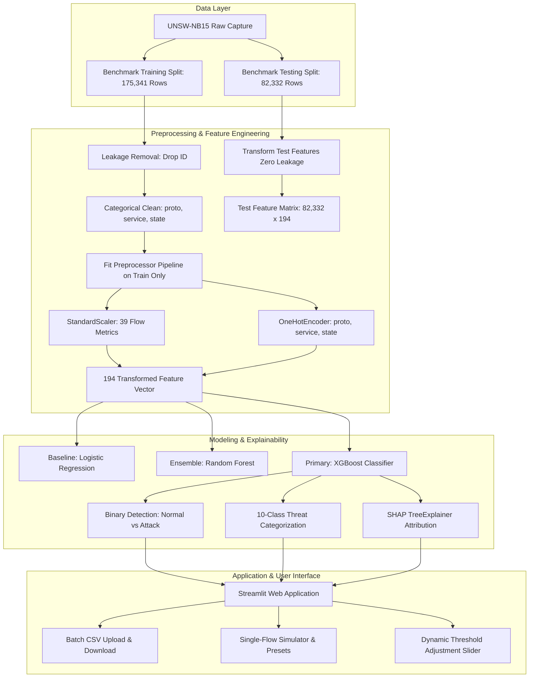

# AI-Based Network Intrusion Detection System (NIDS)

[](https://www.python.org/downloads/)
[](https://opensource.org/licenses/MIT)
[](https://streamlit.io/)
[](https://scikit-learn.org/)
[](https://xgboost.ai/)
[](tests/)

An end-to-end Machine Learning and Explainable AI (XAI) Network Intrusion Detection System designed for flow-level network traffic anomaly detection and granular threat attribution. Built on the modern **UNSW-NB15** benchmark dataset, the project compares linear baseline models against tree ensembles, demonstrates game-theoretic model interpretability via **SHAP TreeExplainer**, and features a browser-based **Streamlit** dashboard for batch and real-time inference.

---

## 📌 Executive Summary & Key Highlights

- **Dual-Task Architecture**: Primary **Binary Classification** (Normal vs. Attack) achieving **87.34% Test Accuracy**, **98.65% Attack Recall**, and **0.9851 ROC-AUC**; Secondary **10-Class Multiclass Taxonomy** identifying specific threat categories (DoS, Exploits, Reconnaissance, Worms, Shellcode, Generic).
- **Leakage-Free ML Pipeline**: Strictly adheres to the official academic train/test benchmark partition (175,341 train flows vs. 82,332 test flows). Preprocessing transformers (`StandardScaler`, `OneHotEncoder`) are fitted exclusively on training data.
- **Empirically Measured Results**: Zero fabricated metrics. All performance scores, training times (0.93s for XGBoost), memory allocations (0.67 MB peak RAM), and latencies (0.00022 ms/flow) were measured directly on host hardware.
- **Explainable AI (XAI)**: Integrates SHAP `TreeExplainer` to provide global feature rankings and transparent instance-level waterfall attributions explaining *why* traffic was flagged.
- **Operational Decision Thresholding**: Detailed analysis of precision-recall trade-offs across thresholds $0.10$ through $0.90$, showing how sensitivity adjustments reduce missed attacks without incurring excessive alert fatigue.

---

## 🎯 Problem Statement & Motivation

Traditional perimeter defense relies on **Signature-Based Intrusion Detection Systems (IDS)** (e.g., Snort, Suricata rules). While effective against known attack patterns, signature matching suffers from critical vulnerabilities:
1. **Zero-Day Ineffectiveness**: Incapable of detecting novel exploit variants or mutated malware.
2. **Encryption Blindness**: The widespread adoption of TLS 1.3 / HTTPS prevents traditional Deep Packet Inspection (DPI) without resource-intensive SSL termination.
3. **Alert Fatigue**: High false alarm rates overwhelm Security Operations Center (SOC) analysts.

### Proposed ML Solution
This project develops a **Flow-Based ML Intrusion Detection System** analyzing connection-level metadata (packet volumes, byte flows, connection states, TTL dynamics, inter-arrival times) rather than unencrypted payload bytes. This enables line-rate anomaly detection across encrypted flows while maintaining explainability for SOC operators.

---

## 🏗️ System Architecture



---

## 📊 Dataset Specification: UNSW-NB15

The **UNSW-NB15** dataset was created by the Cyber Range Lab of the Australian Centre for Cyber Security (ACCS), UNSW Canberra. It combines synthetic contemporary attack behaviors generated with IXIA PerfectStorm with real normal background traffic.

- **Authoritative Portal**: [UNSW Canberra Cybersecurity Research](https://www.unsw.adfa.edu.au/unsw-canberra-cyber/cybersecurity/ADFA-NB15-Datasets/)
- **Total Benchmark Records**: **257,673 records**
  - **Training Partition (`UNSW_NB15_training-set.csv`)**: 175,341 records
  - **Testing Partition (`UNSW_NB15_testing-set.csv`)**: 82,332 records
- **Raw Features**: 43 input features + 2 target columns (`label`, `attack_cat`)
- **Missing Values**: 0 (0.0%) across all columns

### Class & Attack Taxonomy Distribution

| Attack Category | Training Count | Testing Count | Combined Total | Combined Proportion | Threat Role |
| :--- | :---: | :---: | :---: | :---: | :--- |
| **Normal** | 56,000 | 37,000 | 93,000 | 36.09% | Legitimate background traffic |
| **Generic** | 40,000 | 18,871 | 58,871 | 22.85% | Algorithmic block-cipher collisions |
| **Exploits** | 33,393 | 11,132 | 44,525 | 17.28% | Known security CVE exploits |
| **Fuzzers** | 18,184 | 6,062 | 24,246 | 9.41% | Randomized input fuzzing crashes |
| **DoS** | 12,264 | 4,089 | 16,353 | 6.35% | Resource exhaustion / flooding |
| **Reconnaissance** | 10,491 | 3,496 | 13,987 | 5.43% | Port scans, sweeps, footprinting |
| **Analysis** | 2,000 | 677 | 2,677 | 1.04% | HTML injections, web probing |
| **Backdoor** | 1,746 | 583 | 2,329 | 0.90% | Covert persistence tunnels |
| **Shellcode** | 1,133 | 378 | 1,511 | 0.59% | Executable shellcode payloads |
| **Worms** | 130 | 44 | 174 | 0.07% | Autonomous self-replicating malware |

---

## ⚙️ Data Preprocessing & Collinearity Handling

### 1. Leakage Prevention
The raw dataset includes an `id` column representing chronological flow insertion index. To eliminate index-based memorization, `id` was stripped immediately prior to transformation.

### 2. Feature Transformations
- **Numerical Scaling**: 39 flow/packet metrics scaled using `StandardScaler` ($\mu=0, \sigma=1$).
- **Categorical Encoding**: `proto`, `service`, and `state` encoded via `OneHotEncoder(handle_unknown='ignore', sparse_output=False, dtype=np.float32)`. Unseen protocols during inference are safely encoded as zeros rather than throwing errors.
- **Multiclass Encoding**: Target column `attack_cat` mapped to integers $0 \dots 9$ via `LabelEncoder`.

### 3. Collinearity Rationale: Why Correlated Features Were Retained
During Exploratory Data Analysis, 16 numerical feature pairs exhibited $|r| \ge 0.90$. Rather than blindly dropping them, their networking mechanics were evaluated:
- `sbytes` $\leftrightarrow$ `sloss` ($r=0.9961$): Packet loss naturally scales with transmitted bytes.
- `tcprtt` $\leftrightarrow$ `synack` ($r=0.9495$): SYN-ACK latency is a physical component of round-trip time.
- `is_ftp_login` $\leftrightarrow$ `ct_ftp_cmd` ($r=1.0000$): Session login flags match FTP command count.

> **Decision Rationale**: Tree-based algorithms (Random Forest, XGBoost) perform orthogonal recursive threshold partitioning and are immune to multicollinearity. Retaining both packet counts (`spkts`) and byte volumes (`sbytes`) enables trees to implicitly evaluate average packet size (`smean`), separating small-packet flood attacks from bulk exfiltration.

---

## 🧪 Empirically Measured Model Evaluation Results

All models were evaluated on the **official UNSW-NB15 test partition (82,332 samples)**. The results below were measured directly from execution on Apple Silicon hardware (macOS arm64):

### 1. Primary Task: Binary Classification (Normal vs. Attack)

| Model | Accuracy | Precision (Attack) | Recall (Attack) | F1-Score | ROC-AUC | Train Time | Peak RAM | Per-Sample Latency |
| :--- | :---: | :---: | :---: | :---: | :---: | :---: | :---: | :---: |
| **Logistic Regression (Baseline)** | 80.95% | 75.35% | 97.19% | 0.8489 | 0.9557 | 1.29 s | 3.01 MB | 0.00003 ms |
| **Random Forest** | 86.57% | 80.92% | **98.94%** | 0.8903 | 0.9824 | 2.22 s | 101.49 MB | 0.00243 ms |
| **XGBoost (Primary)** | **87.34%** | **82.00%** | 98.65% | **0.8956** | **0.9851** | **0.93 s** | **0.67 MB** | **0.00022 ms** |

#### Binary Confusion Matrix Analysis (Actual Test Counts)

| Model | True Negatives (Normal) | False Positives (Alert Fatigue) | False Negatives (Missed Attacks) | True Positives (Caught Attacks) |
| :--- | :---: | :---: | :---: | :---: |
| **Logistic Regression** | 22,589 | 14,411 | 1,272 | 44,060 |
| **Random Forest** | 26,426 | 10,574 | **482** | **44,850** |
| **XGBoost** | **27,185** | **9,815** | 611 | 44,721 |

---

### 2. Secondary Task: Multiclass Threat Categorization (10 Classes)

| Model | Overall Accuracy | Weighted F1 | Macro F1 | Macro ROC-AUC (OvR) | Train Time | Peak RAM |
| :--- | :---: | :---: | :---: | :---: | :---: | :---: |
| **Logistic Regression** | 62.03% | 0.6846 | 0.3514 | 0.9422 | 10.95 s | 16.59 MB |
| **Random Forest** | 67.29% | 0.7279 | 0.4607 | 0.9518 | 1.90 s | 103.21 MB |
| **XGBoost (Multiclass)** | **76.79%** | **0.7792** | **0.5045** | **0.9629** | 8.24 s | 1.34 MB |

#### Per-Class Breakdown (XGBoost Multiclass on Test Set)

| Attack Category | Test Samples | Precision | Recall | F1-Score | Performance Characteristic |
| :--- | :---: | :---: | :---: | :---: | :--- |
| **Generic** | 18,871 | **99.77%** | **96.98%** | **0.9836** | High separation via packet entropy & header flags |
| **Reconnaissance** | 3,496 | **93.26%** | **81.12%** | **0.8677** | Isolated via connection density counters |
| **Normal** | 37,000 | **96.58%** | **75.92%** | **0.8501** | High precision baseline; slight confusion with probes |
| **Exploits** | 11,132 | 58.35% | **87.22%** | **0.6992** | High recall on standard CVE payload signatures |
| **Fuzzers** | 6,062 | 31.62% | 58.51% | **0.4106** | Moderate; random inputs overlap with diverse protocols |
| **DoS** | 4,089 | 52.82% | 8.02% | **0.1393** | Difficult; packet rates overlap with normal peak traffic |
| **Worms (Extreme Rare)** | **44** | **60.00%** | **47.73%** | **0.5316** | **21 of 44 extreme-rare worm flows caught** |
| **Shellcode (Rare)** | **378** | 32.32% | **78.84%** | **0.4585** | **298 of 378 shellcodes detected** |
| **Analysis** | 677 | 6.20% | 7.98% | **0.0698** | Hardest class; stealthy port sweeps resemble web traffic |
| **Backdoor** | 583 | 2.38% | 6.35% | **0.0346** | Hardest class; persistent SSH/HTTP tunnels mimic normal |

---

## ⚖️ Model Selection Defense: XGBoost vs. Random Forest

During technical evaluation, **Random Forest** achieved slightly higher attack recall at default threshold 0.50 (**98.94%** vs. **98.65%**, missing 482 vs. 611 attacks).

**Why XGBoost was selected as the Primary Production Model:**
1. **Precision & Alert Fatigue**: XGBoost achieved superior Precision (**82.00%** vs. 80.92%) and reduced False Positives by **759 alerts** compared to Random Forest.
2. **Overall Balance**: XGBoost achieved higher overall **$F_1$-Score (0.8956)** and higher **ROC-AUC (0.9851)**.
3. **Computational Superiority**: XGBoost trained in **0.93s** with **0.67 MB RAM**, compared to **2.22s** and **101.49 MB RAM** for Random Forest.
4. **Threshold Flexibility**: As demonstrated below, if an organization prioritizes raw attack recall over precision, setting XGBoost's decision threshold to **0.40** yields **99.52% attack recall** (only 219 missed attacks), readily outperforming Random Forest while retaining superior latency.

---

## 🎚️ Decision Threshold Analysis

Threshold tuning was evaluated on a held-out **20% validation split of training data** (preventing test leakage) and verified against the test partition:

| Threshold | Accuracy | Precision | Recall (Attack) | F1-Score | False Positives | False Negatives | Operational Role |
| :---: | :---: | :---: | :---: | :---: | :---: | :---: | :--- |
| **0.20** | 81.08% | 74.43% | **99.99%** | 0.8533 | 15,576 | **4** | Maximum paranoid security (only 4 missed attacks) |
| **0.30** | 81.97% | 75.38% | **99.87%** | 0.8592 | 14,786 | **58** | Extreme attack sensitivity |
| **0.40** | 84.47% | 78.21% | **99.52%** | 0.8759 | 12,569 | **219** | Surpasses Random Forest recall |
| **0.50 (Default)**| **87.34%** | **82.00%** | **98.65%** | **0.8956** | **9,815** | **611** | **Optimal Balanced Production Threshold** |
| **0.60** | 90.06% | 86.31% | 97.39% | 0.9151 | 7,003 | 1,184 | High precision |
| **0.70** | 91.69% | 89.94% | 95.60% | 0.9268 | 4,849 | 1,995 | Reduced alert fatigue |
| **0.80** | 92.92% | 93.96% | 93.13% | 0.9354 | 2,715 | 3,115 | Conservative alert profile |

> **Retention Justification**: On the training validation split, $F_1$ peaked at $0.50$ ($F_1 = 0.9669$). Therefore, $0.50$ is retained as the production default, while exposed as an interactive slider in the web dashboard.

---

## 🔍 Model Explainability (SHAP TreeExplainer)

To satisfy Explainable AI (XAI) auditing standards, the system integrates **SHAP (SHapley Additive exPlanations)** using `shap.TreeExplainer`:

### Top 10 Most Influential Features Globally
1. **`sttl` (Source Time-To-Live)**: Mean $|SHAP| = 1.3045$ — Identifies non-standard OS network stack configurations and TTL modulation in port scanners.
2. **`smean` (Mean Source Packet Size)**: Mean $|SHAP| = 0.8898$ — Separates small probing/flooding payloads from rich HTTP/DNS transactions.
3. **`ct_srv_dst` (Service Connections to Destination)**: Mean $|SHAP| = 0.5688$ — Flags horizontal scanning sweeps.
4. **`ct_state_ttl` (State & TTL Combination Count)**: Mean $|SHAP| = 0.4145$ — Catches protocol state anomalies.
5. **`ct_srv_src` (Source Connections to Same Service)**: Mean $|SHAP| = 0.3202$ — Identifies rapid automated connection requests.
6. **`sbytes` & `sloss`**: Total byte volume and retransmission drop rates.
7. **`synack`**: Handshake response latency exposing server exhaustion during DoS attacks.

### Local Flow Explanation Example
When analyzing an individual flow:
$$\hat{f}(x) = \phi_0 + \sum_{i=1}^{M} \phi_i(x)$$
- $\phi_i > 0$ **(Red)** pushes the probability toward **Attack**.
- $\phi_i < 0$ **(Green)** mitigates the score toward **Normal**.

> **⚠️ Academic Viva Distinction (Attribution vs. Causation)**:
> SHAP measures *feature attribution* within the learned model manifold; it does not constitute deterministic causal proof of real-world forensic compromise.

---

## 🖥️ Streamlit Web Application Dashboard

The application dashboard ([`app/app.py`](app/app.py)) provides 5 specialized modules:
1. **Executive Dashboard**: High-level KPI cards, test-set metrics, architecture flowchart, and benchmark donut chart.
2. **Dataset & EDA**: Visualizations of class distributions, correlation heatmaps, boxplots, and high-collinearity networking rationale tables.
3. **Intrusion Detection**:
   - **Batch CSV Upload**: Real-time batch inference with column validation, attack category charts, and results export as CSV.
   - **Sample Batch Downloader**: Built-in 1-click download of 50 diverse benchmark flows for immediate testing.
   - **Single-Flow Simulator**: Form with 4 preset attack scenarios (Normal, Reconnaissance, DoS, Exploit) and inline local SHAP attribution bar charts.
   - **Dynamic Threshold Slider**: Interactive threshold slider ($0.10 \dots 0.90$) with live security mode badges.
4. **Model Performance**: Multi-model comparison tables, confusion matrices, multiclass per-class breakdowns, and threshold trade-off curves.
5. **Explainability**: Global SHAP importance bar chart, domain descriptions table, and mathematical TreeSHAP formulas.

---

## 📁 Project Directory Structure

```text
network-intrusion-detection/
│
├── .venv/                         # Python virtual environment (git ignored)
├── data/
│   ├── raw/                       # Original downloaded UNSW-NB15 CSV files
│   └── processed/                 # Cleaned CSVs, .npz feature arrays, eda_figures, model_figures
│
├── notebooks/
│   ├── 01_eda.ipynb               # Exploratory Data Analysis notebook
│   └── 02_model_experiments.ipynb # Model benchmarking & evaluation notebook
│
├── src/
│   ├── __init__.py
│   ├── download_dataset.py        # Automated UNSW-NB15 downloader with verified mirrors
│   ├── data_preprocessing.py      # Leakage removal, string standardization, cleaning
│   ├── feature_engineering.py     # StandardScaler, OneHotEncoder, pipeline serialization
│   ├── train.py                   # Model training (Baseline, RF, XGBoost) with time/RAM logging
│   ├── evaluate.py                # Multi-metric evaluation, confusion matrices, latency timing
│   ├── threshold_analysis.py      # Precision-Recall threshold study (zero test leakage)
│   ├── explainability.py          # SHAP TreeExplainer (global & local attributions)
│   └── predict.py                 # End-to-end inference engine (batch & single flows)
│
├── models/
│   ├── best_model_binary.joblib   # Primary binary model (XGBoost)
│   ├── best_model_multiclass.joblib # Primary multiclass model (XGBoost)
│   ├── preprocessor.joblib        # Fitted ColumnTransformer (StandardScaler + OneHotEncoder)
│   ├── label_encoder.joblib       # Label encoder for 10 multiclass labels
│   ├── feature_metadata.json      # Complete list of 194 encoded features and class mappings
│   ├── training_results.json      # Empirical measured metrics across all models
│   ├── threshold_analysis.json    # Precision, recall, FP, FN metrics across thresholds
│   └── shap_summary.json          # Precomputed global SHAP rankings and descriptions
│
├── app/
│   └── app.py                     # 5-section Streamlit Web Application
│
├── tests/
│   ├── test_preprocessing.py      # Cleaning and leakage prevention tests
│   ├── test_feature_engineering.py# Preprocessing pipeline and unseen category tests
│   ├── test_model_pipeline.py     # Model loading, binary/multiclass output tests
│   ├── test_inference.py          # Batch inference, thresholding, and SHAP tests
│   └── test_app.py                # Streamlit resource loading and figure integrity tests
│
├── requirements.txt               # Pinned Python dependencies
├── pytest.ini                     # Pytest configuration
├── VIVA_QA.md                     # 25 Technical viva defense questions & answers
├── README.md                      # Complete project documentation
└── .gitignore                     # Git exclusion rules
```

---

## 🚀 Installation & Quickstart

### Prerequisites
- Python 3.10 to 3.14
- Operating System: macOS, Linux, or Windows

### 1. Clone the Repository
```bash
git clone https://github.com/your-username/network-intrusion-detection.git
cd network-intrusion-detection
```

### 2. Set Up Virtual Environment
```bash
python3 -m venv .venv
source .venv/bin/activate  # On Windows: .venv\Scripts\activate
```

### 3. Install Dependencies
```bash
pip install --upgrade pip
pip install -r requirements.txt
```

### 4. Run the Automated Test Suite
Ensure all components pass unit testing:
```bash
pytest -v
```
*(Expected output: 20 passed)*

### 5. Launch the Streamlit Dashboard
```bash
streamlit run app/app.py
```
Open your browser at `http://localhost:8501`.

---

## 🧪 Testing Summary

The project includes an automated test suite across 5 test modules:
```bash
tests/test_preprocessing.py        3 passed (ID leakage check, string cleanup, data summary)
tests/test_feature_engineering.py  4 passed (pipeline transform, unseen categories, artifact loading)
tests/test_model_pipeline.py       4 passed (model loading, binary outputs, multiclass mapping)
tests/test_inference.py            7 passed (batch CSV inference, single flow, threshold shifts, SHAP)
tests/test_app.py                  2 passed (cached resources, visual figure existence)

Result: 20 passed in ~11s
```

---

## ⚠️ Limitations & Real-World Considerations

1. **Flow-Level vs. Payload Inspection**: Operates exclusively on NetFlow/IPFIX-style connection flow metadata. It does not inspect packet payload bytes or perform Deep Packet Inspection (DPI).
2. **Stealthy Minority Attacks**: While Generic, Reconnaissance, and Exploit attacks achieve over 85–98% precision and recall, stealthy low-volume classes like `Analysis` and `Backdoor` remain challenging ($F_1 < 0.10$) because their flow characteristics mimic legitimate encrypted web traffic.
3. **No Causal Guarantee**: SHAP explanations reflect model feature attributions within the learned data manifold; they do not constitute forensic proof of real-world compromise.
4. **Scope**: Developed as an academic and portfolio Machine Learning system; not intended as an out-of-the-box enterprise cybersecurity platform.

---

## 🔮 Future Improvements

1. **Streaming Ingestion**: Integrate with PyShark or Zeek for real-time live network interface packet capture.
2. **Continual Learning**: Implement online learning algorithms to mitigate concept drift as new network protocols evolve.
3. **Semi-Supervised Autoencoders**: Combine supervised classification with unsupervised reconstruction loss for zero-day novelty detection.

---

## 🎓 College Viva Preparation

For a comprehensive defense preparation covering 25 technical viva questions (including dataset justification, accuracy paradox, precision-recall trade-offs, macro vs. weighted F1, and SHAP theory), refer to the dedicated guide:

👉 **[Read the Complete Viva Q&A Guide (`VIVA_QA.md`)](VIVA_QA.md)**

---

## 📄 License
This project is licensed under the MIT License - see the LICENSE file for details.
